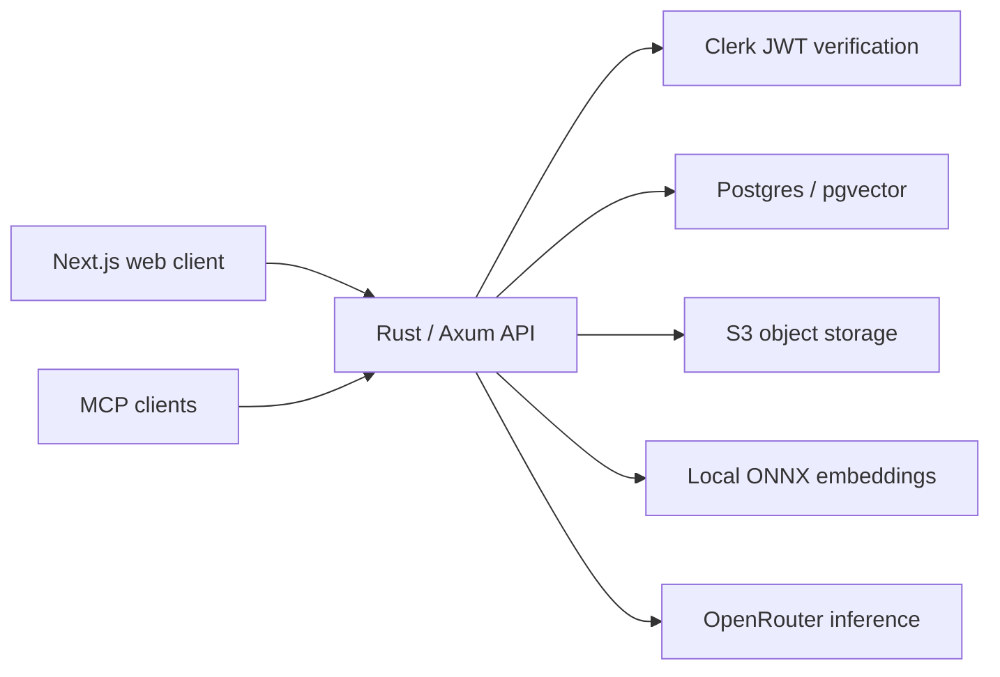

# CoralSwarm

Sunset November 2026, published for reference.

CoralSwarm was a knowledge application that turned notes and connected source material into a searchable knowledge graph. Its web client supported capture, source browsing, and Ask answers grounded in cited evidence; a remote MCP endpoint exposed retrieval to connected clients.



## Design tour

- [Ocean model and promotion](docs/decisions/0006-ocean-model-and-promotion.md): organizing source material and promoted knowledge.
- [Web tenancy and retrieval](docs/decisions/0007-web-v1-tenancy-rag-inference.md): tenant boundaries, storage, and inference.
- [Relationship knowledge graph](docs/decisions/0008-relationship-knowledge-graph.md): relationships alongside source evidence.
- [Conversational Ask](docs/decisions/0009-conversational-ask.md) and [cross-ocean Ask](docs/decisions/0011-ask-v2-cross-ocean-models.md): scoped retrieval and cited responses.
- [Remote MCP](docs/decisions/0012-remote-mcp.md): exposing the knowledge layer to clients.
- [Reef subtypes and ER substrate](docs/decisions/reef-subtypes-and-er-substrate.md): structured relationships and temporal knowledge.
- [Ingest architecture](docs/decisions/0013-jev-ingest-door.md): the evidence pipeline behind retrieval.
- [One ingest door](docs/decisions/0016-one-ingest-door.md): shared ingestion semantics.

ADRs describe decisions at the time they were made, including components subsequently retired. The source includes the backend, web application, CLI, shared packages, extensions, widgets, test harnesses, design documents, and historical marketing website.

## Local development

The Docker setup builds the backend and web from source and uses local pgvector Postgres and S3Mock. Supply your own Clerk development instance and OpenRouter credentials in `.env`, using `.env.example` as the template. No retired service credentials are supplied. OpenRouter inference uses your account and may incur usage charges.

```sh
cp .env.example .env
# Fill in your own development credentials.
docker compose up --build
```

Open http://localhost:3000 after the services are ready; the API is available at http://localhost:8080. Local data and generated encryption secrets persist in Docker volumes.

The database starts empty. Sign in with a personal account, add a note, then ask a question about it. JWT verification remains enabled. Clerk organization webhooks cannot reach localhost; organization provisioning and production integrations are outside the local quickstart. Local ONNX embeddings download during setup. Fake external services are confined to tests.

## Reference workflows and rights

GitHub workflow files are retained as implementation references. GitHub Actions must remain disabled in repository settings; historical deployment workflows are not a supported deployment path and require infrastructure and secrets that are no longer available.

Source published for reference; © CoralSwarm, all rights reserved.

No open-source license is granted for this project. Third-party dependencies and retained third-party notices remain subject to their respective licenses.
